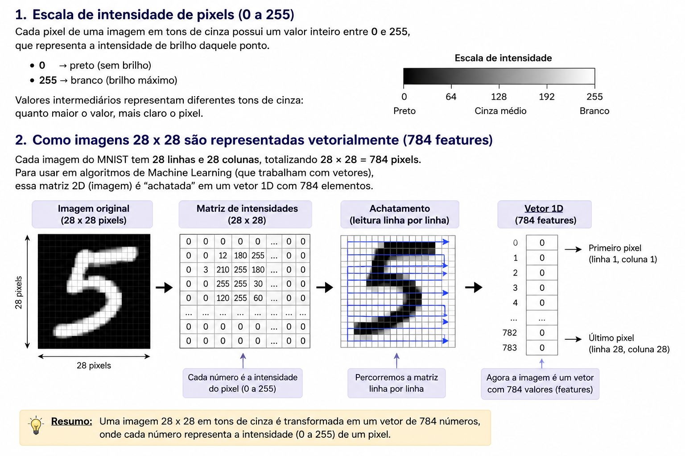

# API de Classificação de Dígitos Manuscritos (MNIST)

API REST, feita com **FastAPI**, que recebe a imagem de um dígito manuscrito (0 a 9) e
devolve o dígito previsto e a confiança do modelo. O modelo é um **MLP (Perceptron
Multicamadas)** treinado com Scikit-Learn no dataset MNIST.

## Problema de negócio

Muitos processos ainda dependem de números escritos à mão: formulários em papel, CEPs
em envelopes, valores em cheques, fichas de cadastro e provas. Digitar esses números
manualmente é lento, caro e sujeito a erros.

O modelo deste projeto **automatiza a leitura de dígitos manuscritos**. Ao publicá-lo
como API, qualquer sistema (um app de digitalização de documentos, uma esteira de
triagem de correspondências, um sistema de OCR) pode enviar a imagem de um dígito por
HTTP e receber a classificação pronta. O sistema que chama a API não precisa saber
nada de Machine Learning.

A API também devolve a **confiança** da predição. Com ela, o sistema cliente pode mandar
para revisão humana os casos em que o modelo está inseguro.

## Origem do modelo

O projeto **aproveita o Mini-Projeto de Módulo 2 (MD2)**: *Classificação de
Dígitos Manuscritos: Comparação de Modelos e Análise de Class Masking, OOD e
Overconfidence*. Nesse projeto foram feitos:

- Treino e comparação de 3 modelos (KNN, Random Forest e MLP) no MNIST, com busca de
  hiperparâmetros via `GridSearchCV` (notebook `mnist.ipynb`).
- Testes de robustez: **class masking** (MLP treinado sem as classes 4 e 7),
  **inferência OOD** (entradas fora da distribuição) e classificação de **fotos
  manuscritas próprias**, com um pipeline de pré-processamento (escala de cinza, remoção
  de sombra, limiar de Otsu, centralização).
- Uma aplicação Streamlit que faz votação por maioria entre os 3 modelos.

O **MLP** foi o modelo escolhido para a API, porque teve o melhor desempenho no conjunto
de teste. Ele está serializado em `models/mlp/mlp.pkl`.

**Base de dados:** [MNIST](https://www.kaggle.com/datasets/hojjatk/mnist-dataset/data),
com 70.000 imagens 28x28 em escala de cinza. É carregada via `fetch_openml`
(`sklearn.datasets`). Cada imagem vira um vetor de 784 pixels com valores de 0 a 255
(dígito claro em fundo escuro).



### Métricas dos modelos

Métricas calculadas no **conjunto de teste**: 20% do MNIST (14.000 imagens), com divisão
estratificada por classe. Precisão, revocação, F1-Score e ROC-AUC são médias ponderadas
pelo número de amostras de cada classe. O ROC-AUC usa a estratégia one-vs-rest.

| Modelo | Acurácia | Precisão | Revocação | F1-Score | ROC-AUC | Tempo de Treino (s) |
|---|---|---|---|---|---|---|
| KNN | 0,9709 | 0,9711 | 0,9709 | 0,9708 | 0,9963 | 0,0067 |
| Random Forest | 0,9681 | 0,9681 | 0,9681 | 0,9681 | 0,9991 | 45,49 |
| **MLP (usado na API)** | **0,9804** | **0,9803** | **0,9804** | **0,9803** | **0,9996** | 8,99 |

## Tecnologias utilizadas

**Linguagem:** Python 3.9

| Biblioteca | Versão | Uso |
|---|---|---|
| FastAPI | 0.128.8 | Framework da API REST |
| Pydantic | 2.13.5 | Validação dos dados de entrada e saída (schemas) |
| Uvicorn | 0.39.0 | Servidor ASGI que executa a API |
| Scikit-Learn | 1.6.1 | Treino e inferência dos modelos (MLP, KNN, Random Forest) |
| NumPy | 2.0.2 | Manipulação dos pixels / vetores |
| Pandas | 2.3.3 | Tabelas de métricas no notebook |
| SciPy | 1.13.1 | Pré-processamento de imagens (`scipy.ndimage`) |
| Scikit-Image | 0.24.0 | Limiar de Otsu no pré-processamento |
| Pillow | 11.3.0 | Leitura e conversão de imagens |
| Matplotlib | 3.9.4 | Gráficos do notebook |
| Streamlit | 1.50.0 | Aplicação web de demonstração |
| ipykernel | 6.31.0 | Execução do notebook Jupyter |

Também são usados **Docker** e **Docker Compose** para empacotar a aplicação Streamlit.

## Estrutura do projeto

```
.
├── api/                       # API REST (FastAPI)
│   ├── main.py                # cria o app e carrega o modelo na inicialização (lifespan)
│   ├── routers.py             # endpoints /health e /predict
│   ├── schemas.py             # schemas Pydantic de entrada e saída
│   └── services.py            # carregamento do modelo e lógica de predição
├── test_API.py                # script de exemplo que envia uma imagem para o /predict
│
├── models/
│   ├── mlp/mlp.pkl            # modelo MLP serializado, usado pela API
│   └── */metricas.json        # métricas de cada modelo
│
├── mnist.ipynb                # notebook: EDA, treino, avaliação, experimentos
├── src/                       # módulos usados pelo notebook
├── config/                    # caminhos, constantes e cache de hiperparâmetros
├── app/                       # aplicação Streamlit (demonstração)
├── outputs/figures/           # gráficos gerados pelo notebook
├── my_images/                 # fotos próprias de dígitos para teste
├── images/                    # imagens da documentação
├── requirements.txt           # dependências do projeto
├── Dockerfile
└── docker-compose.yml
```

## Instalação e execução

### 1. Clonar o repositório

```bash
git clone https://github.com/Jenifer19IFC/SCTEC-Mini-Projeto-MD2.git
cd SCTEC-Mini-Projeto-MD2
```

### 2. Criar e ativar o ambiente virtual (venv)

**Linux / macOS:**

```bash
python3 -m venv venv
source venv/bin/activate
```

**Windows (PowerShell):**

```powershell
python -m venv venv
venv\Scripts\Activate.ps1
```

### 3. Instalar as dependências

```bash
pip install -r requirements.txt
```

### 4. Iniciar o servidor com Uvicorn

O modelo treinado (`models/mlp/mlp.pkl`) já vem no repositório, então não é preciso
rodar o notebook antes. Na raiz do projeto:

```bash
uvicorn api.main:app --reload
```

A API fica disponível em **http://127.0.0.1:8000**. O modelo é lido do disco uma única
vez, quando o servidor inicia, e fica em memória para todas as requisições.

## Documentação da API

### Swagger

Com o servidor rodando, a documentação interativa fica em:

- **Swagger UI:** http://127.0.0.1:8000/docs
- **ReDoc:** http://127.0.0.1:8000/redoc

Pelo Swagger dá para testar os endpoints direto no navegador (botão *Try it out*). O
`/predict` já vem com um exemplo de payload preenchido.

### Endpoints

| Método | Rota | Descrição |
|---|---|---|
| GET | `/health` | Verifica se a API está no ar e se o modelo foi carregado |
| POST | `/predict` | Classifica um dígito manuscrito |

### `GET /health`

**Resposta (200):**

```json
{
  "status": "OK",
  "modelo_carregado": true
}
```

### `POST /predict`

**Corpo da requisição:** o campo `pixels` é uma lista com **exatamente 784 números**. São
os pixels da imagem 28x28 achatada linha a linha, com valores de **0 (preto) a 255
(branco)**. O dígito deve estar claro sobre fundo escuro, como no MNIST.

```json
{
  "pixels": [0, 0, 0, 0, 0, 0, 0, 0, 0, 0, 0, 0, 0, 255, 255, 0, 0, "... (784 valores no total)"]
}
```

O exemplo do Swagger é uma imagem com um traço vertical no centro, parecido com o dígito
**1**. 

**Resposta (200):**

```json
{
  "digito": 1,
  "confianca": 0.9999999867243712
}
```

| Campo | Tipo | Descrição |
|---|---|---|
| `digito` | int | Dígito previsto (0 a 9) |
| `confianca` | float | Probabilidade atribuída pelo modelo ao dígito previsto (0 a 1) |


#### Testando a API com uma imagem (`test_API.py`)

O arquivo [`test_API.py`](test_API.py), na raiz do projeto, é um script de exemplo de
chamada ao `/predict`. Ele abre uma imagem de `my_images/`
(`my_images/dark/6_dark.png`), converte para 28x28 em escala de cinza, achata nos 784
pixels, envia para a API e imprime a resposta (`{'digito': ..., 'confianca': ...}`).

Com o servidor rodando, em outro terminal (com o venv ativo):

```bash
python test_API.py
```

Para testar outra imagem, troque o caminho em `Image.open(...)` no script.

> O `test_API.py` faz apenas a conversão para cinza e o redimensionamento, então funciona
> para imagens já no padrão MNIST (dígito claro, centralizado, em fundo escuro), como as de
> `my_images/dark/`. Para fotos em papel (`my_images/light/`), é preciso o pré-processamento
> completo de `src/manuscript.py` (inversão de cores, remoção de sombra, limiar de Otsu e
> centralização), usado no notebook.

### Respostas de erro

| Código | Quando ocorre | Exemplo de resposta |
|---|---|---|
| 422 | Payload fora do formato: quantidade de pixels diferente de 784, valores fora de 0–255 ou não numéricos | `{"detail": [{"type": "too_short", "loc": ["body", "pixels"], "msg": "List should have at least 784 items after validation, not 3", ...}]}` |
| 400 | Formato válido, mas imagem vazia (todos os pixels em 0) | `{"detail": "Imagem vazia: nenhum dígito foi desenhado."}` |
| 500 | Modelo não carregado ou erro interno na predição | `{"detail": "Erro interno ao executar a predição."}` |

## Aplicação Streamlit (opcional)

O projeto também tem uma interface web, herdada do projeto original. Ela classifica fotos
de dígitos com os 3 modelos e mostra o voto por maioria. A aplicação precisa dos modelos
KNN e Random Forest em `app/models/`, que são gerados ao rodar o `mnist.ipynb` até o fim.

```bash
# Via Docker
docker compose up --build

# Ou direto no venv
streamlit run app/app.py
```

Acesse **http://localhost:8501**.

## Possíveis melhorias futuras

- Endpoint que receba o arquivo de imagem diretamente (upload), com o pré-processamento
  feito na própria API
- Mecanismo de rejeição (responder "não sei") quando a confiança for baixa ou a entrada
  estiver fora da distribuição
- Containerizar também a API (Dockerfile/serviço no `docker-compose.yml`)
- Suporte a múltiplos dígitos na mesma imagem

## Demonstração

- [Vídeo deste projeto (API)](colocar aqui ainda)
- [Vídeo do projeto base (MD2)](https://youtu.be/Q5wTwOeNF98)