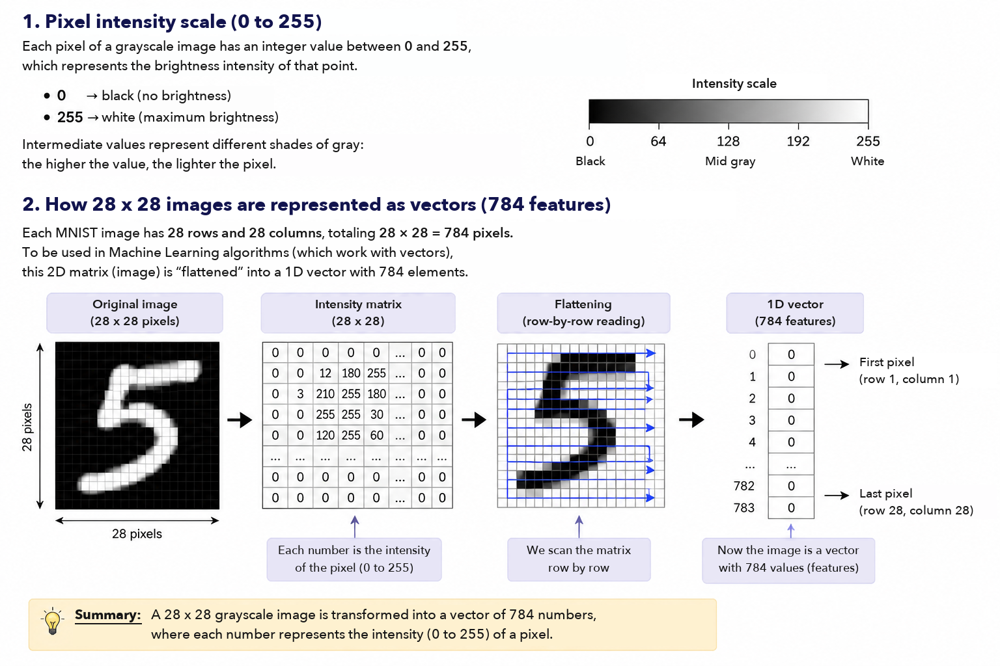

# Handwritten Digit Classification API (MNIST)

A REST API, built with **FastAPI**, that receives the image of a handwritten digit (0 to 9) and
returns the predicted digit and the model's confidence. The model is an **MLP (Multilayer
Perceptron)** trained with Scikit-Learn on the MNIST dataset.

## Business problem

Many processes still rely on handwritten numbers: paper forms, ZIP codes
on envelopes, amounts on checks, registration forms and exams. Typing these numbers
manually is slow, expensive and error-prone.

The model in this project **automates the reading of handwritten digits**. By publishing it
as an API, any system (a document digitization app, a mail sorting
pipeline, an OCR system) can send the image of a digit over
HTTP and receive the classification ready to use. The system calling the API doesn't need to know
anything about Machine Learning.

The API also returns the prediction's **confidence**. With it, the client system can send
the cases where the model is uncertain to human review.

## Model origin

The project **builds on the Module 2 Mini-Project (MD2)**: *Handwritten Digit
Classification: Model Comparison and Analysis of Class Masking, OOD and
Overconfidence*. That project included:

- Training and comparison of 3 models (KNN, Random Forest and MLP) on MNIST, with
  hyperparameter search via `GridSearchCV` (notebook `mnist.ipynb`).
- Robustness tests: **class masking** (MLP trained without classes 4 and 7),
  **OOD inference** (out-of-distribution inputs) and classification of **my own
  handwritten photos**, with a preprocessing pipeline (grayscale, shadow
  removal, Otsu thresholding, centering).
- A Streamlit application that performs majority voting among the 3 models.

The **MLP** was the model chosen for the API, because it had the best performance on the test
set. It is serialized in `models/mlp/mlp.pkl`.

**Dataset:** [MNIST](https://www.kaggle.com/datasets/hojjatk/mnist-dataset/data),
with 70,000 28x28 grayscale images. It is loaded via `fetch_openml`
(`sklearn.datasets`). Each image becomes a vector of 784 pixels with values from 0 to 255
(light digit on a dark background).



### Model metrics

Metrics computed on the **test set**: 20% of MNIST (14,000 images), with a
class-stratified split. Precision, recall, F1-Score and ROC-AUC are averages weighted
by the number of samples in each class. ROC-AUC uses the one-vs-rest strategy.

| Model | Accuracy | Precision | Recall | F1-Score | ROC-AUC | Training Time (s) |
|---|---|---|---|---|---|---|
| KNN | 0.9709 | 0.9711 | 0.9709 | 0.9708 | 0.9963 | 0.0067 |
| Random Forest | 0.9681 | 0.9681 | 0.9681 | 0.9681 | 0.9991 | 45.49 |
| **MLP (used in the API)** | **0.9804** | **0.9803** | **0.9804** | **0.9803** | **0.9996** | 8.99 |

## Technologies used

**Language:** Python 3.9

| Library | Version | Usage |
|---|---|---|
| FastAPI | 0.128.8 | REST API framework |
| Pydantic | 2.13.5 | Input and output data validation (schemas) |
| Uvicorn | 0.39.0 | ASGI server that runs the API |
| Scikit-Learn | 1.6.1 | Model training and inference (MLP, KNN, Random Forest) |
| NumPy | 2.0.2 | Pixel / vector manipulation |
| Pandas | 2.3.3 | Metrics tables in the notebook |
| SciPy | 1.13.1 | Image preprocessing (`scipy.ndimage`) |
| Scikit-Image | 0.24.0 | Otsu thresholding in preprocessing |
| Pillow | 11.3.0 | Image reading and conversion |
| Matplotlib | 3.9.4 | Notebook charts |
| Streamlit | 1.50.0 | Demo web application |
| ipykernel | 6.31.0 | Running the Jupyter notebook |

**Docker** and **Docker Compose** are also used to package the Streamlit application.

## Project structure

```
.
├── api/                       # REST API (FastAPI)
│   ├── main.py                # creates the app and loads the model on startup (lifespan)
│   ├── routers.py             # /health and /predict endpoints
│   ├── schemas.py             # Pydantic input and output schemas
│   └── services.py            # model loading and prediction logic
├── test_API.py                # example script that sends an image to /predict
│
├── models/
│   ├── mlp/mlp.pkl            # serialized MLP model, used by the API
│   └── */metricas.json        # metrics for each model
│
├── mnist.ipynb                # notebook: EDA, training, evaluation, experiments
├── src/                       # modules used by the notebook
├── config/                    # paths, constants and hyperparameter cache
├── app/                       # Streamlit application (demo)
├── outputs/figures/           # charts generated by the notebook
├── my_images/                 # my own digit photos for testing
├── images/                    # documentation images
├── requirements.txt           # project dependencies
├── Dockerfile
└── docker-compose.yml
```

## Installation and running

### 1. Clone the repository

```bash
git clone https://github.com/Jenifer19IFC/SCTEC-Mini-Projeto-MD2.git
cd SCTEC-Mini-Projeto-MD2
```

### 2. Create and activate the virtual environment (venv)

**Linux / macOS:**

```bash
python3 -m venv venv
source venv/bin/activate
```

**Windows (PowerShell):**

```powershell
python -m venv venv
venv\Scripts\Activate.ps1
```

### 3. Install the dependencies

```bash
pip install -r requirements.txt
```

### 4. Start the server with Uvicorn

The trained model (`models/mlp/mlp.pkl`) is already included in the repository, so there's no need to
run the notebook first. From the project root:

```bash
uvicorn api.main:app --reload
```

The API will be available at **http://127.0.0.1:8000**. The model is read from disk only
once, when the server starts, and stays in memory for all requests.

## API documentation

### Swagger

With the server running, the interactive documentation is available at:

- **Swagger UI:** http://127.0.0.1:8000/docs
- **ReDoc:** http://127.0.0.1:8000/redoc

Through Swagger you can test the endpoints directly in the browser (*Try it out* button). The
`/predict` endpoint comes with a pre-filled example payload.

### Endpoints

| Method | Route | Description |
|---|---|---|
| GET | `/health` | Checks whether the API is up and the model has been loaded |
| POST | `/predict` | Classifies a handwritten digit |

### `GET /health`

**Response (200):**

```json
{
  "status": "OK",
  "modelo_carregado": true
}
```

### `POST /predict`

**Request body:** the `pixels` field is a list of **exactly 784 numbers**. These are
the pixels of the 28x28 image flattened row by row, with values from **0 (black) to 255
(white)**. The digit must be light on a dark background, as in MNIST.

```json
{
  "pixels": [0, 0, 0, 0, 0, 0, 0, 0, 0, 0, 0, 0, 0, 255, 255, 0, 0, "... (784 values in total)"]
}
```

The Swagger example is an image with a vertical stroke in the center, similar to the digit
**1**. 

**Response (200):**

```json
{
  "digito": 1,
  "confianca": 0.9999999867243712
}
```

| Field | Type | Description |
|---|---|---|
| `digito` | int | Predicted digit (0 to 9) |
| `confianca` | float | Probability assigned by the model to the predicted digit (0 to 1) |


#### Testing the API with an image (`test_API.py`)

The [`test_API.py`](test_API.py) file, in the project root, is an example script that
calls `/predict`. It opens an image from `my_images/`
(`my_images/dark/6_dark.png`), converts it to 28x28 grayscale, flattens it into the 784
pixels, sends it to the API and prints the response (`{'digito': ..., 'confianca': ...}`).

With the server running, in another terminal (with the venv active):

```bash
python test_API.py
```

To test another image, change the path in `Image.open(...)` in the script.

> `test_API.py` only performs grayscale conversion and resizing, so it works
> for images already in the MNIST format (light, centered digit on a dark background), such as those in
> `my_images/dark/`. For photos on paper (`my_images/light/`), the full preprocessing
> from `src/manuscript.py` (color inversion, shadow removal, Otsu thresholding and
> centering), used in the notebook, is required.

### Error responses

| Code | When it occurs | Example response |
|---|---|---|
| 422 | Malformed payload: number of pixels other than 784, values outside 0–255 or non-numeric | `{"detail": [{"type": "too_short", "loc": ["body", "pixels"], "msg": "List should have at least 784 items after validation, not 3", ...}]}` |
| 400 | Valid format, but empty image (all pixels set to 0) | `{"detail": "Imagem vazia: nenhum dígito foi desenhado."}` |
| 500 | Model not loaded or internal error during prediction | `{"detail": "Erro interno ao executar a predição."}` |

## Streamlit application (optional)

The project also has a web interface, inherited from the original project. It classifies photos
of digits with the 3 models and shows the majority vote. The application requires the
KNN and Random Forest models in `app/models/`, which are generated by running `mnist.ipynb` to the end.

```bash
# Via Docker
docker compose up --build

# Or directly in the venv
streamlit run app/app.py
```

Go to **http://localhost:8501**.

## Possible future improvements

- An endpoint that receives the image file directly (upload), with preprocessing
  done in the API itself
- A rejection mechanism (answering "I don't know") when confidence is low or the input
  is out of distribution
- Containerize the API as well (Dockerfile/service in `docker-compose.yml`)
- Support for multiple digits in the same image

## Demo

- [API video](https://youtu.be/hYgR2FYq-Fk)
- [Base project video (MD2)](https://youtu.be/Q5wTwOeNF98)
